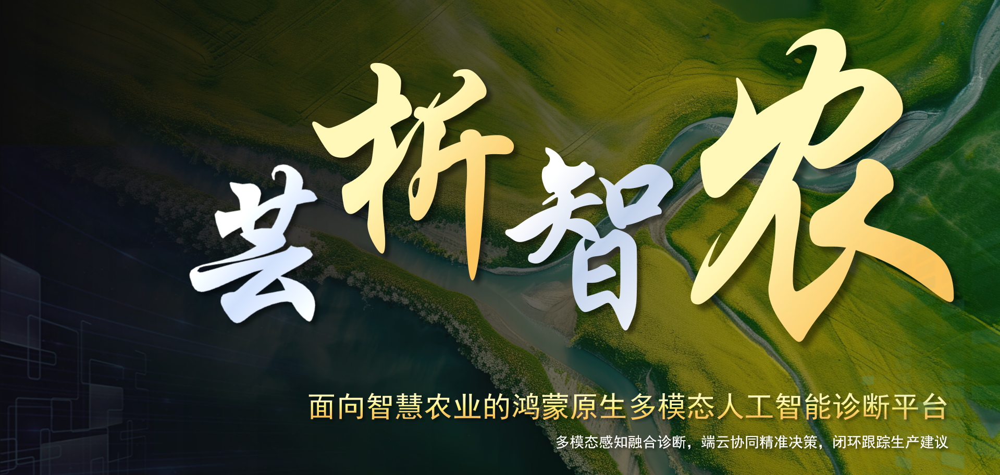
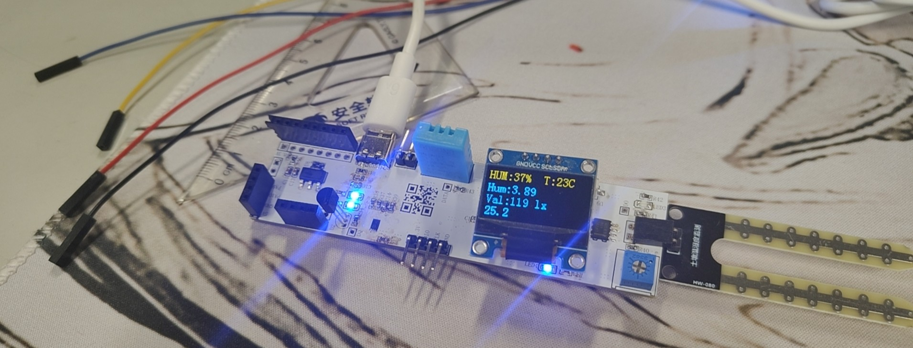
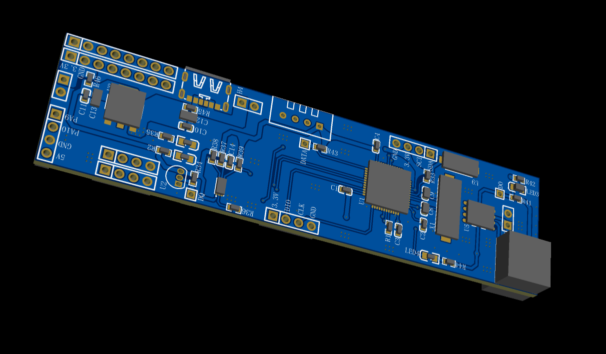
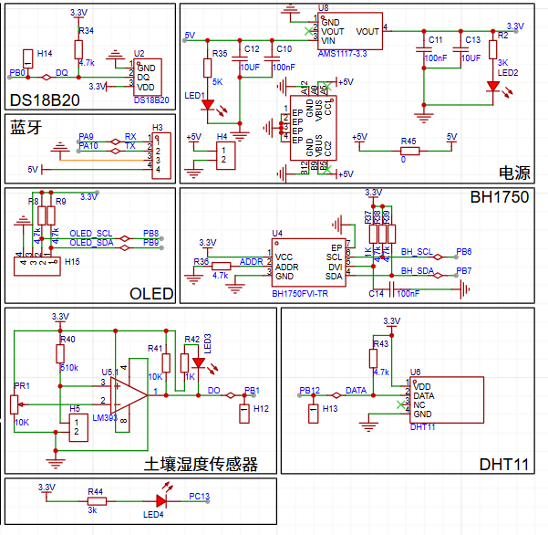
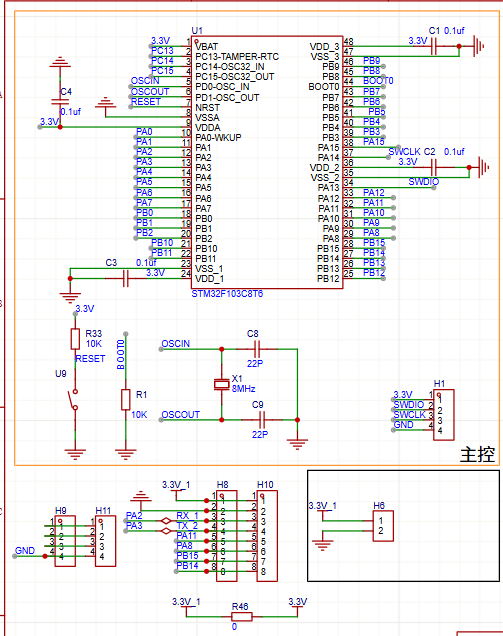
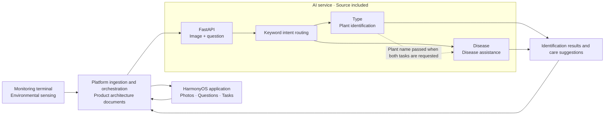

<div align="center">


# YunXi · 芸析智农

**Grow with insight. Turn advice into action.**

HarmonyOS application × Custom agricultural sensors × Multimodal AI

[简体中文](README.md) · **English**

[Overview](#overview) · [Showcase](#showcase) · [Architecture](#architecture) · [Quick start](#quickstart) · [Documentation](#documentation)



</div>

<a id="overview"></a>

## Overview

YunXi is a smart agriculture project for growers, family farms and cooperatives. It connects environmental monitoring, plant images and natural language questions to help users understand crop conditions and obtain practical growing advice.

The product follows a **sense → analyze → advise → act → learn** workflow. A custom terminal collects environmental data, a HarmonyOS application supports interaction and tasks, and an AI service provides plant identification and disease assistance. This repository brings together product documentation, the AI service implementation and hardware visuals.

> **Stage: campus pilot and functional validation.** Project materials describe initial hardware–software integration and campus demonstrations. This repository includes AI service source code, product documents and hardware images. HarmonyOS application source code, the complete business backend, model weights and training data are not included.

### Core capabilities

| Area | Product capability | Entry point |
| --- | --- | --- |
| Plant identification | Upload an image and ask for the plant name | [AI service overview](ai/README.md) |
| Disease assistance | Return disease information, possible causes and care suggestions | [API reference](ai/API_DOCUMENTATION.md) |
| Environmental sensing | Custom monitoring hardware and sensing plans for temperature, humidity, light and soil temperature | [Hardware showcase](#showcase) |
| HarmonyOS experience | Photography, voice interaction, diagnosis views, growing plans and reminders | [Application overview](app/README.md) |
| Product design | User research, MVP planning, AI design, evaluation and retrospectives | [Documentation index](docs/README.md) |

The included AI code implements image and text inputs, keyword intent routing, lazy loading of two models and result handling. Sensor fusion, RAG, cloud review, cross-device collaboration and secure records are covered in the broader product and architecture documents.

<a id="showcase"></a>

## Showcase

### Custom agricultural monitoring terminal

<table>
  <tr>
    <th width="50%">Hardware prototype</th>
    <th width="50%">3D PCB design</th>
  </tr>
  <tr>
    <td align="center"></td>
    <td align="center"></td>
  </tr>
</table>

<details>
<summary>View PCB design images</summary>

| Design view 1 | Design view 2 |
| --- | --- |
|  |  |

</details>

### Application and milestones

- **Application experience:** See the [HarmonyOS application overview](app/README.md) and [Pixso interaction design](https://pixso.cn/app/design/GSp4PGXB6jx3L8a7BNWjOw?file_type=10&icon_type=1&page-id=0%3A1).
- **Project milestones:** Project materials report initial hardware–software integration, campus demonstrations, provincial approval under the 2026 undergraduate innovation training program and a software copyright application.
- **Retrospective:** Read about [individual responsibilities, teamwork and validation results](docs/09_项目复盘与个人贡献.md). Campus metrics refer to specific evaluation conditions and are not general performance guarantees for this codebase.

<a id="architecture"></a>

## Architecture

This diagram summarizes the overall product architecture. The implementation available for direct inspection in this repository is concentrated in the **AI service**.



### Technology and repository scope

| Module | Technology or design | Included here |
| --- | --- | --- |
| AI API | Python 3.13, FastAPI, Uvicorn | API source code, dependencies and usage documentation |
| Vision language models | Qwen2.5-VL, Transformers, PyTorch | Loading, prompts, inference and parsing; bring your own weights |
| HarmonyOS application | ArkTS / ArkUI, Vision Kit, Speech Kit and related capabilities | Application description and an external design link |
| Agricultural terminal | Sensor acquisition and 4G connectivity | Prototype photos and PCB design images |
| Platform extensions | OneNet, InfluxDB, RAG, SSE and secure records | Product proposals, architecture and mock API contracts |

Type and Disease are two model loading paths within one process. Type-only questions use Type, disease-only questions use Disease, and combined questions run Type → Disease sequentially.

<a id="quickstart"></a>

## Quick start

These steps run the standalone **AI HTTP service**. The full application and hardware workflow require additional software and devices.

### 1. Prepare Python and model files

- Use Python **3.13**, matching the interpreter range in [`ai/pyproject.toml`](ai/pyproject.toml).
- Prepare a compatible PyTorch environment for your hardware. The code selects GPU or CPU based on CUDA availability.
- Supply Qwen2.5-VL model weights, configuration and processor files compatible with the loading code in `ai/Type/` and `ai/Disease/`. Model weights and download scripts are not included.

```text
ai/
├── Type/              # Plant identification model and processor files
├── Disease/           # Disease analysis model and processor files
├── api_service.py
└── model_loader.py
```

### 2. Install dependencies and start the service

Run these commands from the repository root. The PowerShell example does not require virtual environment activation:

```powershell
py -3.13 -m venv .venv
.\.venv\Scripts\python.exe -m pip install -r ai/requirements.txt
cd ai
..\.venv\Scripts\python.exe -m uvicorn api_service:app --host 127.0.0.1 --port 8000 --workers 1
```

<details>
<summary>Linux / macOS commands</summary>

```bash
python3.13 -m venv .venv
.venv/bin/python -m pip install -r ai/requirements.txt
cd ai
../.venv/bin/python -m uvicorn api_service:app --host 127.0.0.1 --port 8000 --workers 1
```

</details>

Open [Swagger UI](http://127.0.0.1:8000/docs) or check [`/health`](http://127.0.0.1:8000/health) after startup. A model with status `not_loaded` has not been requested yet; model files are only validated when loading is first attempted.

### 3. Send a prediction request

Keep the service running and open another PowerShell window at the repository root. Use your own plant photo:

```powershell
curl.exe --max-time 300 -X POST "http://127.0.0.1:8000/predict" `
  -F "image=@plant.jpg" `
  -F "question=这是什么植物？它怎么了？"
```

Replace `plant.jpg` with an actual image path. The question means “What plant is this? What is wrong with it?” The current keyword router primarily supports Chinese questions, so the request intentionally uses Chinese.

| Endpoint | Purpose |
| --- | --- |
| `POST /predict` | Submit `image` and `question`; receive results for the detected intent |
| `GET /health` | Inspect service initialization and model loading status |
| `GET /model/info` | Inspect model paths, devices and loading status |
| `GET /docs` | Explore and try the API through Swagger UI |

The first prediction includes model loading time, and CPU inference may be slow. Set the caller's read timeout to at least 300 seconds. Use one worker and avoid automatic reload to prevent duplicate model loading. See the [API reference](ai/API_DOCUMENTATION.md) for response fields, error handling and deployment constraints.

<a id="documentation"></a>

## Documentation

The linked project documents are currently in Chinese.

| Topic | Start here |
| --- | --- |
| Background, users and positioning | [Project introduction](docs/00_项目简介.md) · [User research](docs/01_用户研究与需求洞察.md) |
| Product decisions and delivery | [Decisions and tradeoffs](docs/03_关键决策与取舍.md) · [MVP planning](docs/04_MVP规划与排期.md) |
| AI design, evaluation and metrics | [AI design](docs/05_AI方案设计.md) · [Model evaluation](docs/06_模型评估与迭代.md) · [Metrics](docs/07_指标体系与数据方案.md) |
| Releases and individual contributions | [Releases and iteration](docs/08_上线与版本迭代.md) · [Retrospective](docs/09_项目复盘与个人贡献.md) |
| Service code and system interfaces | [AI engineering](ai/README.md) · [API reference](ai/API_DOCUMENTATION.md) · [Platform architecture](docs/10_系统架构与接口.md) |
| All project materials | [Documentation index](docs/README.md) · [Project proposal](docs/02_项目申报书.pdf) |

### Repository layout

```text
Yunxi_Intelligent_Agriculture/
├── README.md                # Chinese overview
├── README.en.md             # English overview
├── LICENSE
├── ai/                      # AI service source, dependencies and API reference
├── app/                     # Application overview and design link
├── docs/                    # Research, design, evaluation and retrospectives
│   └── assets/              # README icon, banner and technology badges
└── hardware/                # Prototype and PCB images
```

## Next steps

- Expand validation across crops, seasons and challenging imaging conditions; improve Golden Set and Bad Case management.
- Re-evaluate quality, latency and resource usage under consistent hardware, dataset and concurrency conditions.
- Pilot on real plots to assess advice outcomes and long-term terminal reliability.

See [Model evaluation and iteration](docs/06_模型评估与迭代.md) for the evaluation plan.

## Contributing and license

Suggestions on API usability, model evaluation, agricultural use cases and documentation are welcome. Include your environment, reproduction steps and anonymized examples when reporting a problem. Describe the purpose and validation of any proposed change.

The project is developed by He Xingyi (何幸仪) and the team. See [the retrospective](docs/09_项目复盘与个人贡献.md) for responsibilities and collaboration. Thanks to Qwen, FastAPI, PyTorch, Transformers and the HarmonyOS ecosystem.

See [LICENSE](LICENSE) for this repository's license. External models, datasets and third-party resources remain subject to their own terms. AI output supports growing decisions; complex diseases and high-risk actions require agricultural expertise.

<div align="center">

<sub>YunXi · Sense. Understand. Act.</sub>

</div>
