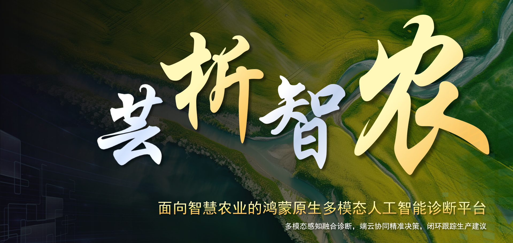
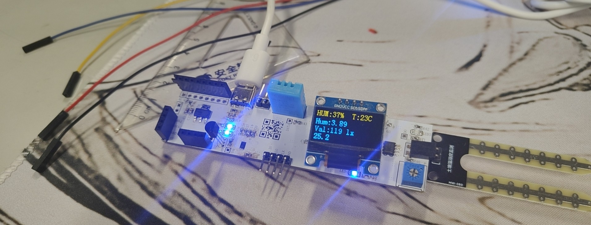
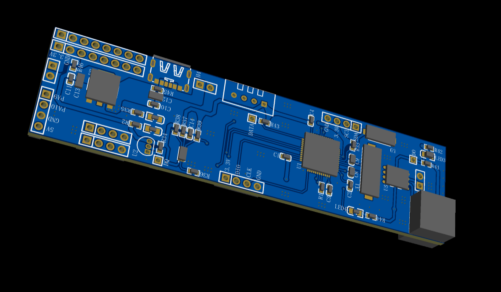
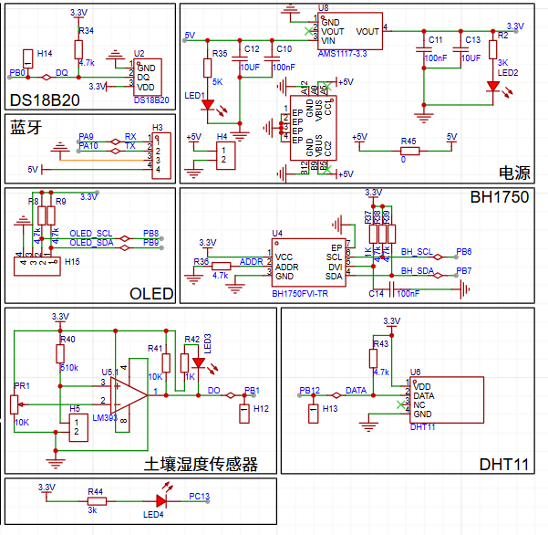
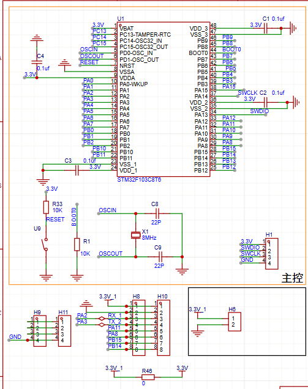
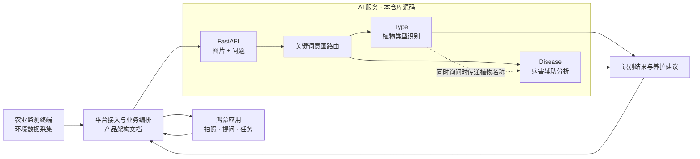

<div align="center">


# 芸析智农 · YunXi

**让种植有据可依，让建议落到行动。**

鸿蒙原生应用 × 自研农业监测终端 × 多模态 AI 辅助诊断

**简体中文** · [English](README.en.md)

[项目介绍](#overview) · [项目展示](#showcase) · [系统架构](#architecture) · [快速开始](#quickstart) · [文档导航](#documentation)



</div>

<a id="overview"></a>

## 项目介绍

芸析智农面向农户、家庭农场与合作社，将环境监测、植物图像和自然语言问题连接起来，帮助用户了解作物状态，并获得可理解、可执行的种植建议。

项目围绕 **感知 → 分析 → 建议 → 执行 → 反馈** 展开：自研终端采集种植环境数据，鸿蒙应用承载交互与任务，AI 服务提供植物类型识别和病害辅助分析。本仓库集中展示产品设计、AI 服务实现与硬件成果。

> **当前阶段：校园小试与功能验证。** 项目材料记录了软硬件初步对接与校内演示；当前仓库包含 AI 服务源码、产品文档及硬件图片，尚未收录鸿蒙应用源码、完整业务后端、模型权重和训练数据。

### 核心能力

| 方向 | 产品能力 | 阅读入口 |
| --- | --- | --- |
| 植物识别 | 上传植物图片，通过自然语言询问植物名称 | [AI 服务说明](ai/README.md) |
| 病害分析 | 返回病害名称、可能原因及养护建议 | [API 接口文档](ai/API_DOCUMENTATION.md) |
| 环境感知 | 自研监测终端与温湿度、光照、土壤温度等采集方案 | [硬件展示](#showcase) |
| 鸿蒙应用 | 拍照、语音、诊断展示、种植计划与提醒的产品体验 | [应用说明](app/README.md) |
| 产品设计 | 用户研究、MVP、AI 方案、评估指标与项目复盘 | [完整文档索引](docs/README.md) |

AI 服务现有代码实现了图像与文本问题输入、关键词意图路由、两个模型的按需加载及结果返回。传感器融合、RAG、云端疑难复核、多端协同和安全存证等完整平台能力，详见产品与架构文档。

<a id="showcase"></a>

## 项目展示

### 自研农业监测终端

<table>
  <tr>
    <th width="50%">硬件实物</th>
    <th width="50%">PCB 三维设计</th>
  </tr>
  <tr>
    <td align="center"></td>
    <td align="center"></td>
  </tr>
</table>

<details>
<summary>查看 PCB 设计稿</summary>

| 设计稿一 | 设计稿二 |
| --- | --- |
|  |  |

</details>

### 应用与阶段成果

- **应用体验：** 查看 [应用说明](app/README.md) 与 [Pixso 交互设计稿](https://pixso.cn/app/design/GSp4PGXB6jx3L8a7BNWjOw?file_type=10&icon_type=1&page-id=0%3A1)。
- **阶段进展：** 据项目材料，已完成软硬件初步对接及校内流程演示，获 2026 年度大学生创新训练计划省级立项，应用已申请软件著作权。
- **项目复盘：** [个人职责、团队协作与验证结果](docs/09_项目复盘与个人贡献.md)。材料中的校内指标对应特定验证环境，不能直接作为此仓库代码的通用性能承诺。

<a id="architecture"></a>

## 系统架构

以下为产品整体架构概览；当前仓库可直接检查的实现集中在 **AI 服务** 部分。



### 技术栈与实现范围

| 模块 | 技术或方案 | 当前仓库内容 |
| --- | --- | --- |
| AI 接口 | Python 3.13、FastAPI、Uvicorn | 接口源码、依赖与调用说明 |
| 视觉语言模型 | Qwen2.5-VL、Transformers、PyTorch | 模型加载、提示词、推理与解析代码；权重需另备 |
| 鸿蒙应用 | ArkTS / ArkUI、Vision Kit、Speech Kit 等 | 应用介绍与外部设计稿入口 |
| 农业终端 | 传感器采集、4G 通信 | 实物照片与 PCB 设计图片 |
| 平台扩展 | OneNet、InfluxDB、RAG、SSE、安全存证 | 产品方案、架构说明与接口 Mock |

AI 服务中的 Type 与 Disease 是同一进程内的两个模型加载入口。只问类型时调用 Type，只问病害时调用 Disease，同时询问时依次执行 Type → Disease。

<a id="quickstart"></a>

## 文档导航

| 你想了解什么 | 从这里开始 |
| --- | --- |
| 项目背景、用户与产品定位 | [项目简介](docs/00_项目简介.md) · [用户研究](docs/01_用户研究与需求洞察.md) |
| 产品决策与交付计划 | [关键决策与取舍](docs/03_关键决策与取舍.md) · [MVP 规划](docs/04_MVP规划与排期.md) |
| AI 方案、效果评估与指标 | [AI 方案设计](docs/05_AI方案设计.md) · [模型评估](docs/06_模型评估与迭代.md) · [指标体系](docs/07_指标体系与数据方案.md) |
| 版本迭代与个人贡献 | [上线与迭代](docs/08_上线与版本迭代.md) · [项目复盘](docs/09_项目复盘与个人贡献.md) |
| 服务代码与系统接口 | [AI 工程说明](ai/README.md) · [API 文档](ai/API_DOCUMENTATION.md) · [平台架构](docs/10_系统架构与接口.md) |
| 全部项目材料 | [文档索引](docs/README.md) · [项目申报书](docs/02_项目申报书.pdf) |

### 仓库结构

```text
Yunxi_Intelligent_Agriculture/
├── README.md                # 中文首页
├── README.en.md             # English overview
├── LICENSE
├── ai/                      # AI 服务源码、依赖与接口文档
├── app/                     # 应用说明与设计稿入口
├── docs/                    # 产品研究、方案、评估与复盘
│   └── assets/              # README 图标、横幅与技术徽章
└── hardware/                # 硬件实物与 PCB 设计图片
```

## 后续方向

- 扩展跨作物、跨季节与复杂拍摄条件的验证，完善 Golden Set 与 Bad Case 管理。
- 在统一硬件、数据集与并发条件下复测模型效果、时延及资源占用。
- 推进真实地块试点，验证建议执行效果及终端长期稳定性。

详细评估计划见 [模型评估与迭代](docs/06_模型评估与迭代.md)。

## 参与与许可

欢迎围绕接口易用性、模型评估、农业场景和文档提出建议。反馈时请附上运行环境、复现步骤及脱敏后的示例；提交改动时请说明变更目的和验证方式。

项目由何幸仪及团队共同推进，职责与协作过程见 [项目复盘与个人贡献](docs/09_项目复盘与个人贡献.md)。感谢 Qwen、FastAPI、PyTorch、Transformers 及鸿蒙生态提供的基础能力。

本仓库许可证见 [LICENSE](LICENSE)。外部模型、数据集及第三方资源的使用须遵守各自的许可条款。AI 输出用于种植辅助决策，复杂病害与高风险处置需结合农技人员判断。

<div align="center">

<sub>YunXi · Sense. Understand. Act.</sub>

</div>
>>>>>>> cc602fb (first commit)
