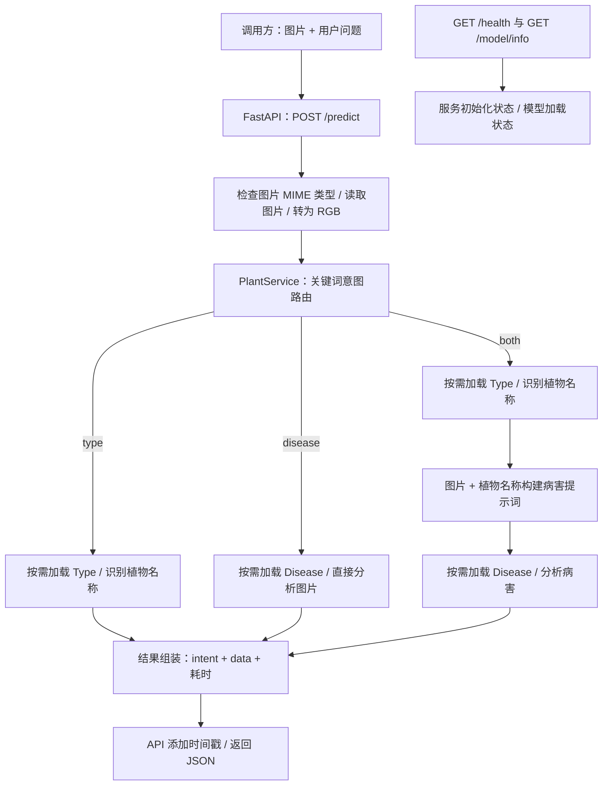

# YunXi｜基于 Qwen2.5-VL 的植物识别与病害分析服务

YunXi 将“这是什么植物？”和“它怎么了？”两个用户需求，拆成植物类型识别、植物病害分析两项能力。用户上传一张图片并输入问题，服务通过关键词规则判断意图，按需调用对应的本地视觉语言模型，返回植物名称或病害、原因及养护建议。

本项目适合作为 AI 产品经理作品集中的**多模态 AI 服务工程案例**，重点展示从用户需求、任务拆分、模型编排到接口交付的设计。当前材料能证明服务代码与接口设计已具备，尚不能证明识别准确率、模型微调效果或生产环境表现。

> 本文仅依据 `API_DOCUMENTATION.md`、`api_service.py`、`model_loader.py`、`plant_service.log`、`pyproject.toml`、`requirements.txt` 编写，未检查 `Type/`、`Disease/` 内的权重与配置。模型架构名称以代码使用的 `Qwen2_5_VLForConditionalGeneration` 为依据。

## 1. 用户需求与产品交付

| 用户问题示例 | 意图 | 调用路径 | 返回给业务端的字段 |
| --- | --- | --- | --- |
| 这是什么植物？ | `type` | Type | `plant_type` |
| 叶子发黄是什么病？ | `disease` | Disease | `disease`、`cause`、`treatment` |
| 这是什么花？它怎么了？ | `both` | Type → Disease | 上述四个字段 |

产品设计的重点是让用户用自然语言表达需求，业务端通过同一个接口获取对应结果。只问类型时无需执行病害分析，只问病害时也不会先强制识别植物类型；同时询问两者时，再把植物名称作为病害分析的上下文。

## 2. 工程架构



### 分层与职责

| 层次 | 代码位置 | 主要职责 |
| --- | --- | --- |
| API 接入层 | `api_service.py` | 接收文件与表单、图片解码、HTTP 状态码、响应封装、请求日志、健康检查 |
| 服务编排层 | `model_loader.py` 中的 `PlantService` | 意图分类、选择执行路径、延迟加载模型、传递植物名称、汇总结果与计时 |
| 模型适配层 | `PlantTypeModel`、`PlantDiseaseModel` | 为不同任务构建提示词、调用处理器和模型、清理或解析模型输出 |
| 共用推理能力 | `_load_qwen_vl`、`_prepare_inputs`、`_decode_generated` | 统一权重加载、图文输入构建和新增 token 解码 |
| 本地模型资源 | `./Type`、`./Disease` | 分别供两个模型实例加载；权重不包含在作品集建议上传范围内 |

这是单个 Python 服务进程内的分层设计。Type 与 Disease 是两个模型封装及独立加载入口，并非两个独立部署的微服务。两者都使用 Qwen2.5-VL 架构。

### 三条路径如何工作

1. **仅识别类型**：`PlantTypeModel` 接收图片，提示模型只输出植物中文名称，最多生成 50 个 token。结果写入 `plant_type`。
2. **仅分析病害**：`PlantDiseaseModel` 直接接收图片，使用通用植物病害提示词，最多生成 512 个 token，并尝试解析病害、原因和处理建议。
3. **同时识别两者**：先执行 Type，再将得到的植物名称填入 Disease 的提示词。名称为空或为“未知植物”时，使用通用病害提示词。两个模型按顺序执行。

## 3. 关键架构决策及产品含义

### 用规则路由控制调用范围

`PlantService.classify_intent()` 先去除问题中的空白并转为小写，再匹配类型和病害关键词，输出 `type`、`disease` 或 `both`。空问题与无法匹配的问题返回 HTTP 400。

这种方式让路由逻辑可以直接检查，也无需额外调用大模型判断意图。代价是对表达方式敏感，可能漏掉未覆盖的说法，也不能可靠理解否定句和复杂语义。作品集中可展示这一取舍，但路由准确率仍需用真实问题集验证。

### 按需加载，加载后复用

服务启动时创建 `PlantService`，两个模型对象初始均为 `None`。首次需要某项能力时才加载对应模型，随后在同一进程内复用实例。每个模型的初始化使用锁和二次检查，避免同一进程内重复初始化。

这使服务无需在启动阶段就加载两个模型，并避免从未使用的模型提前占用资源；首次调用则需要承担冷启动等待。当前没有模型卸载或缓存淘汰机制，两个模型都使用过后，会同时保留在内存或显存中。初始化锁也不等于推理队列或并发调度器。

### 共用推理流程，分别约束任务输出

模型通过 `AutoProcessor` 构建文本 token 和图像张量，使用 `torch.float16` 加载，根据 CUDA 是否可用选择 GPU 或 CPU，并以 `eval()`、`torch.no_grad()` 和 `do_sample=False` 执行生成。解码时仅保留新增 token，避免把输入对话混入结果。

Type 通过提示词约束输出植物名称；Disease 通过提示词要求返回 JSON，再用正则提取和 `json.loads()` 解析。这为业务端提供了较稳定的字段入口，但不是模型层面的严格结构化输出保证，目前也没有完整的字段类型与业务语义校验。

FP16 的代码意图是控制权重加载的内存占用。具体硬件要求、CPU 兼容性与运行性能，需要在目标机器上实际验证。

### 把模型结果封装成业务接口

`POST /predict` 使用统一入口接收 `image` 和 `question`，通过 `intent` 告知调用方应读取哪些结果字段。HTTP 异常封装为带 `message` 的错误响应；缺少必填参数时，仍使用 FastAPI 的 HTTP 422 `detail` 格式。

这让前端或业务后端可以围绕明确的接口契约开展联调，而无需直接操作模型。完整参数、状态码和多语言调用示例见 [API_DOCUMENTATION.md](API_DOCUMENTATION.md)。

## 4. 接口与结果示例

| 接口 | 用途 | 需要理解的边界 |
| --- | --- | --- |
| `POST /predict` | 上传图片和问题，执行预测 | 字段随 `intent` 变化；首次请求可能包含模型加载时间 |
| `GET /health` | 查询服务初始化与模型加载状态 | `not_loaded` 是正常的延迟加载状态；健康检查不验证推理结果 |
| `GET /model/info` | 查询模型路径、设备与加载状态 | 未加载时设备为 `null` |
| `GET /docs` | Swagger UI 接口文档 | 服务启动后访问 |

以下为响应结构示意，不是本次实测结果：

```json
{
  "status": "success",
  "intent": "both",
  "data": {
    "plant_type": "月季",
    "disease": "健康",
    "cause": "无病害",
    "treatment": "继续正常养护即可"
  },
  "processing_time_ms": 130456.78,
  "timestamp": "2026-08-12T11:00:00.000000"
}
```

`processing_time_ms` 统计 `PlantService.predict()` 内的处理时间，包含意图判断、可能发生的模型加载以及模型推理，不包含此前的图片读取、解码，也不等同于客户端端到端等待时间。
